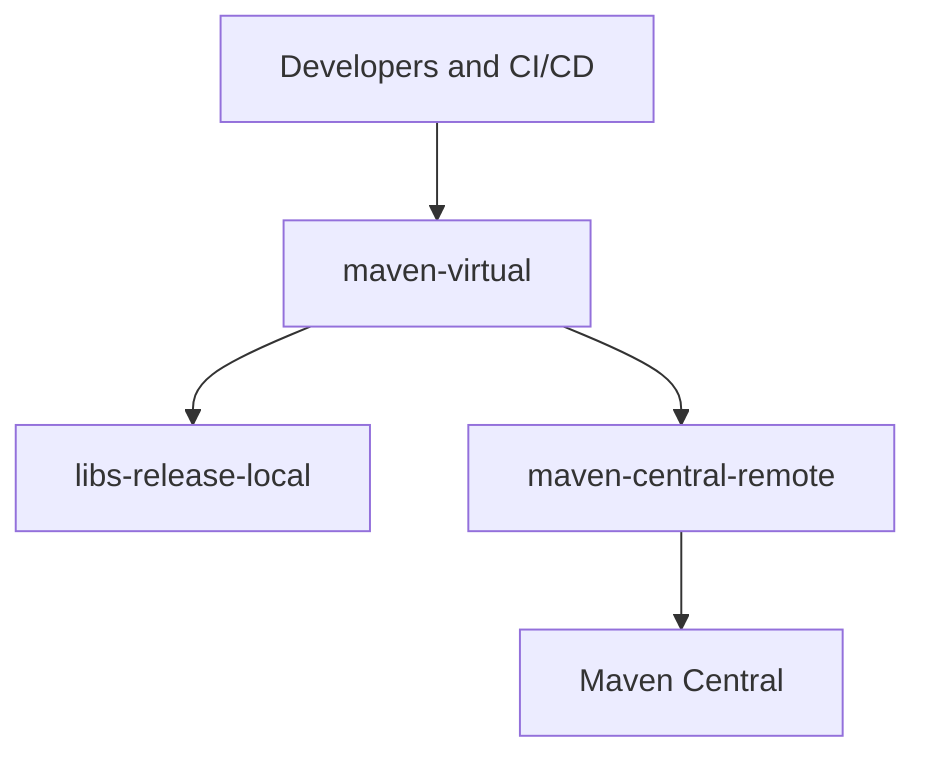

# Phase 05 — Maven remote and virtual repositories

## Objective
Centralize internal and external Maven dependency resolution through Artifactory as part of the enterprise DevSecOps master project.

## Concepts and business use
- Local: stores internally published artifacts, e.g. libs-release-local.
- Remote: proxies and caches external packages, e.g. Maven Central. Cached packages can reduce external traffic and improve subsequent builds; uncached packages still depend on upstream availability.
- Virtual: aggregates repositories behind one URL, simplifying developer and CI configuration.

## Architecture

## Configuration completed (user confirmed)
Administration > Repositories > Create a Repository.
Remote: Maven, maven-central-remote, https://repo.maven.apache.org/maven2/, releases enabled, snapshots disabled, no upstream credentials.
Virtual: Maven, maven-virtual, members libs-release-local and maven-central-remote, local first, default deployment repository libs-release-local.
Endpoint: https://trialgccoro.jfrog.io/artifactory/maven-virtual

The default deployment repository routes supported deployments to a local member, subject to permissions. Virtual repositories do not themselves store artifacts.

## Production practices
Use a unified resolution endpoint, grant developers read access, grant CI deployment only where needed, protect internal namespaces from dependency confusion, and integrate security scanning where available. Remote caching alone does not establish package trust.

## Verification and troubleshooting
Repository creation is user-confirmed; dependency resolution and caching are not yet tested. Next: grant scoped read access for Maven resolution, configure a Maven settings mirror and test with an isolated local cache. For 401 check credentials; for 403 check permissions; for missing artifacts check virtual membership and upstream availability.

## Interview questions
- Why use remote repositories? Centralized proxying and caching of external dependencies.
- Local vs virtual? Local stores artifacts; virtual aggregates access.
- Can a virtual repository accept deployments? Supported deployments can route to its configured default local repository with appropriate permissions.
- Does caching guarantee offline builds? No, all required artifacts and metadata must be available.

## Master project roadmap
Reuse completed exercises 01–04 (Maven, Docker, permissions, CI/CD). Continue with dependency resolution, Docker proxy, CLI, Build Info, environment strategy, Xray, policies, REST API/AQL, promotion, automated CI/CD, OIDC, Kubernetes, rollback, retention, monitoring and enterprise administration. Trial-dependent features are subject to entitlement. Capture explanations, configurations, commands, troubleshooting, verification and interview notes in each phase.
