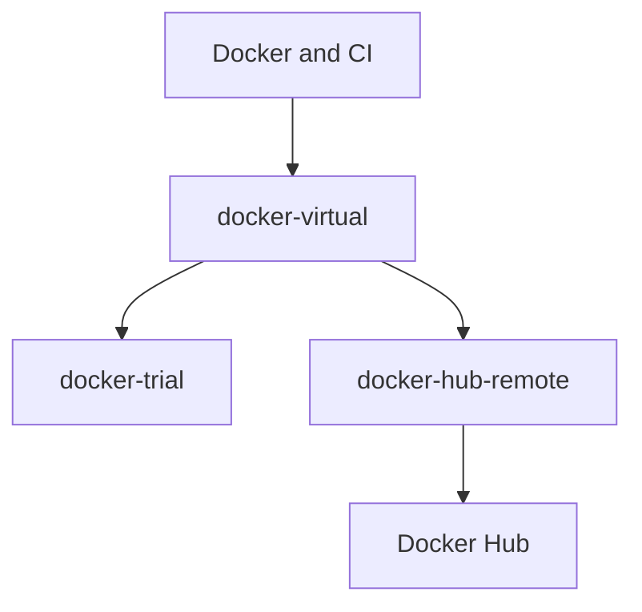

# Phase 07 — Docker Hub proxy and caching

## Objective and enterprise use
Reuse docker-trial for internal images. Proxy Docker Hub through a remote repository and later combine both using a virtual repository. This centralizes access, reduces repeated upstream downloads and exposure to upstream rate limits, and enables security policy integration where licensed. Caching does not guarantee offline availability or image trust.

## Step 1 — Create remote repository (pending)
Administration > Repositories > Create a Repository > Remote > Docker. Key: docker-hub-remote. Upstream URL: https://registry-1.docker.io/ (use Docker Hub preset if offered). Leave other defaults; anonymous upstream access for public images initially, subject to rate limits. Check for an equivalent existing repository first. Do not enter JFrog credentials as upstream Docker Hub credentials. Test and save. Next configure scoped permissions and verify a pull through JFrog.

## Step 2 — Docker remote permissions (pending confirmation)
Proceeding after user requested next step following remote creation instructions; repository creation has not been independently verified. Create permission target docker-dependency-read for docker-hub-remote and existing maven-deployer user. Enable Read and Deploy/Cache; disable Delete/Overwrite, Annotate and Manage. Read allows access to cached artifacts and Deploy/Cache allows new upstream artifacts to be cached. Reuse existing valid token subject to scope. This demonstrates repository-level authorization; production environments should separate developer, CI publishing and runtime identities. Next create a Docker virtual repository and verify image resolution.
