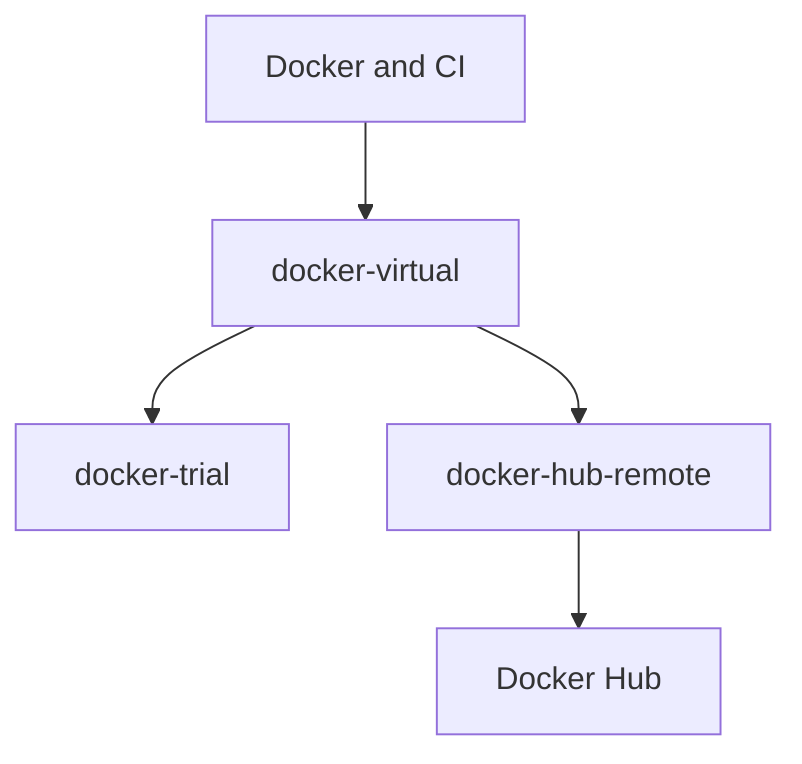

# Phase 07 — Docker Hub proxy and caching

## Objective and enterprise use
Reuse docker-trial for internal images. Proxy Docker Hub through a remote repository and later combine both using a virtual repository. This centralizes access, reduces repeated upstream downloads and exposure to upstream rate limits, and enables security policy integration where licensed. Caching does not guarantee offline availability or image trust.



## Step 1 — Create remote repository (pending)
Administration > Repositories > Create a Repository > Remote > Docker. Key: docker-hub-remote. Upstream URL: https://registry-1.docker.io/ (use Docker Hub preset if offered). Leave other defaults; anonymous upstream access for public images initially, subject to rate limits. Check for an equivalent existing repository first. Do not enter JFrog credentials as upstream Docker Hub credentials. Test and save. Next configure scoped permissions and verify a pull through JFrog.

## Step 2 — Docker remote permissions (pending confirmation)
Proceeding after user requested next step following remote creation instructions; repository creation has not been independently verified. Create permission target docker-dependency-read for docker-hub-remote and existing maven-deployer user. Enable Read and Deploy/Cache; disable Delete/Overwrite, Annotate and Manage. Read allows access to cached artifacts and Deploy/Cache allows new upstream artifacts to be cached. Reuse existing valid token subject to scope. This demonstrates repository-level authorization; production environments should separate developer, CI publishing and runtime identities. Next create a Docker virtual repository and verify image resolution.

## Step 2 verification
User confirmed saving Docker remote permissions.

## Step 3 — Docker virtual repository (pending)
Administration > Repositories > Create a Repository > Virtual > Docker. Key docker-virtual; members docker-trial (first) and docker-hub-remote; default deployment repository docker-trial. Reuse existing local repository. Example image reference: trialgccoro.jfrog.io/docker-virtual/nginx:alpine instead of nginx:alpine directly from Docker Hub. Verify actual resolution in the next step. Dockerfiles, CI agents and Kubernetes can consume images via a unified registry endpoint, enabling shared caching and centralized permissions. Virtual repository creation does not enforce blocking direct Docker Hub access; separate network or organizational controls are required. Security scanning depends on entitlement and configuration.

## Step 3 verification
User confirmed creation of docker-virtual.

## Step 4 — Pull external image (pending verification)
```powershell
docker pull trialgccoro.jfrog.io/docker-virtual/nginx:alpine
```
If authentication is required, reuse the existing configured credentials:
```powershell
$env:JFROG_TOKEN | docker login trialgccoro.jfrog.io --username $env:JFROG_USER --password-stdin
```
The virtual repository resolves the image through its members; the remote repository checks its cache and retrieves missing content from Docker Hub. Unlike direct Docker Hub pulls, this provides a centralized access point and shared server-side caching. Use cases include Dockerfile base images, CI agents and Kubernetes workloads. Production deployments should pin approved image digests rather than relying solely on mutable tags. Pull success and server-side cache inspection are pending.

## Troubleshooting — Docker Engine unavailable
User reported `failed to connect to the docker API at npipe:////./pipe/dockerDesktopLinuxEngine` and `The system cannot find the file specified`. Registry login returned `Login Succeeded`, but the pull still failed. This indicates an unavailable local Docker engine rather than an established JFrog authorization failure. Docker login can authenticate without the engine; image pulls require it.

```powershell
Start-Process "$env:ProgramFiles\Docker\Docker\Docker Desktop.exe"
# Wait until engine is running
docker info
docker pull trialgccoro.jfrog.io/docker-virtual/nginx:alpine
```
Verify server information in docker info. Do not rotate tokens or change repository permissions based solely on this error. Resolution and pull verification pending.

## Why proxy Docker Hub instead of pulling directly?
Direct `docker pull nginx:alpine` is valid and often sufficient for personal projects. Enterprises use Artifactory as a shared proxy/cache, unified internal/external registry endpoint, centralized authorization and audit layer, and integration point for configured Xray security policies. For example, hundreds of developers and CI agents can reuse cached image content, reducing repeated upstream traffic and exposure to rate limits. Cached availability during outages depends on content and configuration; a proxy alone does not guarantee security or block direct internet access.

Dockerfile example: `FROM trialgccoro.jfrog.io/docker-virtual/eclipse-temurin:17-jre` instead of `FROM eclipse-temurin:17-jre`. Kubernetes image example: `trialgccoro.jfrog.io/docker-virtual/nginx:alpine` with appropriate registry authentication. Production should pin approved digests. JFrog is not mandatory for Docker; its value is organizational governance, security integration, reliability and scale. Interview question: Why use Artifactory when Docker Hub is available? Explain the shared proxy, access controls, unified endpoint and security policy integration.

## Step 4 verification
User reported successful external nginx:alpine pull through docker-virtual after Docker Engine troubleshooting. Full pull output was not supplied.

## Step 5 — Inspect server-side Docker cache (pending)
In Application > Artifactory > Artifacts, inspect docker-hub-remote-cache for nginx:alpine (typically library/nginx; exact tree varies). Look for manifests and cached content. Docker images comprise manifests, configuration and filesystem layers; an image index may reference platform-specific manifests. Digests identify content, whereas tags are mutable references. Identical layers can be reused, reducing repeated downloads and storage duplication. Enterprise example: multiple Java microservices share base image layers. Cache inspection remains pending.

## Completion
User confirmed inspecting the Docker server-side cache. Phase 07 is complete based on user confirmation of the external image pull and cache inspection. Continue to JFrog CLI.

## Final documentation audit

Status: Docker proxy and caching exercise completed
based on user-confirmed pull and cache inspection.

Configured repositories:

- docker-trial
- docker-hub-remote
- docker-virtual

Demonstrated image:

trialgccoro.jfrog.io/docker-virtual/nginx:alpine

The Docker Engine connectivity issue was resolved before
the user reported successful image retrieval.

Full pull logs were not retained in this guide.
Offline availability and upstream access enforcement
were not independently tested.
