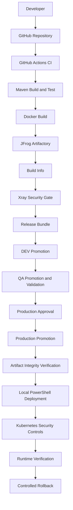

# Enterprise JFrog Master Project

A hands-on DevSecOps learning project covering Java, Maven, Docker,
JFrog Artifactory, Xray, GitHub Actions, OIDC, Kubernetes, artifact
promotion, release management, deployment and rollback.

## 1. Project status

The 19-phase practical implementation has been completed as a
learning lab. Production-style release promotion, artifact integrity,
Kubernetes deployment and rollback were successfully exercised.

This project is not a certified production-ready implementation.
Documentation auditing and some advanced administrative topics
remain outstanding.

## 2. Technology stack

| Technology | Purpose |
|---|---|
| Java 17 | Application development |
| Maven | Build and dependency management |
| Docker | Container packaging |
| JFrog Artifactory | Artifact management |
| JFrog Xray | Vulnerability scanning and security policies |
| JFrog CLI | Artifact and release automation |
| GitHub Actions | CI/CD automation |
| OIDC | Federated authentication |
| Kubernetes | Application deployment |
| Minikube | Local Kubernetes environment |
| PowerShell | Windows deployment and rollback automation |
| Bash | Linux CI/CD and integrity automation |
| SHA256 | Artifact integrity verification |

## 3. Enterprise architecture

## 4. Complete practical learning guides

| Phase | Topic | Documentation |
|---|---|---|
| 01 | Maven, Docker and Artifactory | [Guide](./01-maven-docker-artifactory) |
| 02 | JFrog users and permissions | [Guide](./02-jfrog-user-permissions) |
| 03 | Maven CI/CD | [Guide](./03-github-actions-cicd) |
| 04 | Docker CI/CD | [Guide](./04-docker-cicd) |
| 05 | Remote and virtual repositories | [Guide](./05-remote-virtual-repositories) |
| 06 | Maven dependency resolution | [Guide](./06-maven-dependency-resolution) |
| 07 | Docker Hub proxy and caching | [Guide](./07-docker-hub-proxy) |
| 08 | JFrog CLI | [Guide](./08-jfrog-cli) |
| 09 | Build Info and traceability | [Guide](./09-build-info) |
| 10 | Enterprise repository strategy | [Guide](./10-repository-strategy) |
| 11 | Xray security | [Guide](./11-xray-security) |
| 12 | Security policies and watches | [Guide](./12-security-policies-watches) |
| 13 | Artifact properties, REST API and AQL | [Guide](./13-artifact-properties-rest-aql) |
| 14 | Artifact promotion | [Guide](./14-artifact-promotion) |
| 15 | Enterprise CI/CD | [Guide](./15-enterprise-cicd) |
| 16 | OIDC authentication | [Guide](./16-oidc-authentication) |
| 17 | Kubernetes deployment | [Guide](./17-kubernetes-deployment) |
| 18 | Release management and rollback | [Guide](./18-release-management-rollback) |
| 19 | Automated enterprise release | [Guide](./19-automated-enterprise-release) |

## 5. Enterprise release information

| Property | Value |
|---|---|
| Release Bundle | enterprise-demo-release |
| Release version | 1.0.8 |
| Artifact version | 1.0.7-ci-45636994469-1 |
| Build name | enterprise-release-ci |
| Build number | 45636994469-1 |
| Kubernetes namespace | enterprise-prod |
| Target architecture | linux/amd64 |
| Runtime user | 10001:10001 |

## 6. Enterprise implementation

- Restricted deployment and promotion identities
- Maven and Docker CI/CD
- Build Info publication
- Remote and virtual repositories
- Xray vulnerability scanning
- Fail-closed security validation
- GitHub OIDC authentication
- Release Bundle v2
- DEV, QA and PROD promotion
- Production approval gates
- SHA256 artifact verification
- Digest-pinned Docker deployment
- Kubernetes ServiceAccounts and RBAC
- Validating Admission Policies
- Restricted Pod Security Admission
- Resource quotas and limits
- Default-deny NetworkPolicy configuration
- Non-root container execution
- Automated local deployment
- Controlled rollback and policy restoration
- Audit evidence generation

## 7. Verified release results

| Validation | Result |
|---|---|
| Source CI workflow | PASSED |
| Release Bundle creation | PASSED |
| DEV promotion | PASSED |
| QA promotion and validation | PASSED |
| Production approval and promotion | PASSED |
| Maven artifact integrity checks | 6/6 PASSED |
| Docker artifact metadata checks | 39/39 PASSED |
| Additional Docker index digest checks | 3/3 PASSED |
| Production runtime smoke test | PASSED |
| Kubernetes deployment | PASSED |
| Controlled Kubernetes rollback | PASSED |
| Admission policy restoration | PASSED |
| Unauthorized rollback rejection | PASSED |

The artifact inventory contained 15 artifacts.
Verification across three environments produced 45 artifact checks
and three additional Docker index digest checks.

## 8. Xray security results

| Severity | Production build scan | Rollback image scan |
|---|---:|---:|
| Critical | 0 | 0 |
| High | 0 | 0 |
| Medium | 54 | 55 |
| Low | 4 | 4 |

The configured gate blocked High and Critical vulnerabilities.
Medium and Low findings remained and require remediation or
documented risk acceptance in a real production environment.

## 9. GitHub Actions execution evidence

| Workflow | Execution |
|---|---|
| Enterprise CI with OIDC | [Run](../../actions/runs/45636994469) |
| Release authentication | [Run](../../actions/runs/45821908854) |
| Release Bundle creation | [Run](../../actions/runs/45823508305) |
| DEV promotion | [Run](../../actions/runs/45823906662) |
| QA promotion | [Run](../../actions/runs/45824284048) |
| Production promotion | [Run](../../actions/runs/45826565840) |
| Enterprise integrity verification | [Run](../../actions/runs/45929475846) |

Workflow artifacts are subject to retention policies.
Important evidence should be archived before expiration.

## 10. Getting started

Required tools:

- Java 17 and Maven
- Git and GitHub CLI
- Docker Desktop
- JFrog CLI
- PowerShell
- kubectl and Minikube
- A GitHub repository
- A JFrog environment with appropriate entitlements

Replace all training-specific repository URLs and release identifiers
with values appropriate to your environment.

Configure restricted identities and GitHub environment secrets.
Never commit credentials, access tokens or private configuration.

Follow the individual phase guides in order.

## 11. Backup and local cleanup

Local cleanup was performed on November 27, 2026.

Preserved:

- Original IntelliJ project
- GitHub project source and documentation
- Production and rollback Docker image archives
- Maven JAR and POM artifacts
- Build Info JSON
- Downloaded QA, production and integrity evidence directories

Five archived files passed SHA256 manifest verification.
The Maven JAR and POM also matched the original release baseline.

Removed:

- Minikube clusters
- Docker images, containers, volumes and build cache
- Dedicated JFrog CLI configurations
- JFrog Docker registry authentication
- Dedicated Maven test repositories and JFrog settings

The default Maven settings and dependency repository were retained.
All development tools were retained.

Remote token revocation and complete CI evidence recovery
were not confirmed at the time of this update.

Some ignored local Kubernetes audit evidence was deleted during
cleanup and is not recoverable from Git.

## 12. Known limitations

- This implementation is a learning lab, not production certification.
- Kubernetes deployment was performed locally using Minikube.
- NetworkPolicy enforcement was not independently verified.
- Deployment automation uses local PowerShell rather than an
  unattended GitHub Actions deployment runner.
- Production approval used a solo learning environment.
- Release automation reused an existing successful CI build.
- Fresh artifact transfer across every environment was not proven.
- Docker artifact inventory checks used repository checksum metadata,
  not independent byte-level hashing of every Docker blob.
- Rollback reruns a previous batch Job and does not reverse side effects.
- Rollback policy restoration can be affected by abrupt termination
  or Kubernetes API unavailability.
- Audit evidence is unsigned.
- Some workflows and scripts are specific to the demonstrated release.
- Full license scanning coverage was not independently audited.
- A fresh-user end-to-end documentation reproduction remains pending.
- Original Windows source files were not independently compared
  against the reconstructed Phase 01 repository sample.

## 13. Original roadmap reconciliation

The original roadmap contained 21 planned phases.

The implemented repository contains 19 practical phase guides,
with Phase 19 covering the final automated enterprise release.

Advanced cleanup, retention policy management, storage optimization,
monitoring, server backup, disaster recovery and high availability
remain separate administrative learning topics.

These topics must not be represented as completed practical exercises
without further implementation and verification.

The training JFrog trial was reported to expire on December 4, 2026.
Feature availability depends on the JFrog subscription.

## 14. Documentation maintenance

The root README is the master navigation and project summary.

Individual phase guides contain implementation instructions,
commands, configuration examples and exercise results.

Documentation auditing must verify each phase against the available
source files, workflow definitions and recorded evidence.

